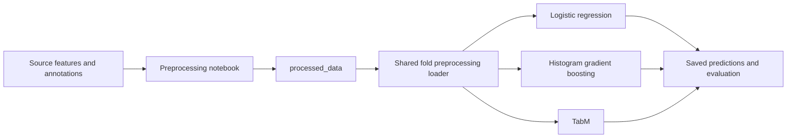

# AFIB classification with noisy or missing ECG measurements

Aaditya Pathak · Siwen Wang · Jiayi Huang

COMP90051 Statistical Machine Learning

We will compare logistic regression, histogram gradient boosting and TabM to
find whether feature construction and training augmentation improve AFIB
classification when extracted ECG measurements are incomplete or noisy.
Data preparation and the logistic-regression implementation are available.
See `algorithms/logistic_regression/README.md` for running and checking its results.
TabM training and tuning are implemented; its generated completion report records
which experiments have finished. Histogram gradient boosting and the full
three-model comparison remain pending.

## Start here

| File or folder | One purpose |
| --- | --- |
| [Project plan](docs/Project_Plan.docx) | What we will test, how we will run it, and how we will judge the results |
| [Data insights](docs/Data_Insights.docx) | Dataset characteristics and findings from the completed analysis |
| [Preprocessing guide](docs/Preprocessing.docx) | How source data becomes the shared model input |
| [Preprocessing notebook](notebooks/01_preprocessing.ipynb) | Validate and package data into `processed_data/` |
| [Data insights notebook](notebooks/00_data_insights.ipynb) | Reproduce descriptive findings and display their plots |
| [Algorithms](algorithms/) | Separate work folders for the three selected classifiers |
| [TabM tuning notebook](notebooks/05_tabm_tuning.ipynb) | Run individual block settings, complete nested tuning and inspect TabM results |
| [TabM outputs](models/tabm/) | Dedicated prediction data, tuning histories and reports |
| [Evaluation notebook](notebooks/02_noise_evaluation.ipynb) | Check saved predictions and calculate results after training |
| [Imputation check](notebooks/03_imputation_reliability.ipynb) | Separate engineering check for the optional learned-filling experiment |
| `src/afib/` and `tests/` | Shared preparation, evaluation and imputation code and checks |

## Run preprocessing

Use Python 3.12 from this repository folder:

```powershell
python -m pip install -r requirements.txt
python -m unittest discover -s tests -v
python -m jupyter lab notebooks/01_preprocessing.ipynb
```

Download the three CSVs from the dataset links below and keep this layout
(the PTB-XL+ folder may have any name; keep only one active copy):

```text
data/
  ptb-xl-plus/
    features/ecgdeli_features.csv
    labels/ptbxl_statements.csv
  reference/ptbxl_database.csv
```

Run the notebook top to bottom. For a command-line run without saving another notebook:

```powershell
python scripts/execute_notebook.py notebooks/01_preprocessing.ipynb
```

Its only generated deliverable is **`processed_data/`**. The folder holds the
selected measurements, labels, patient folds, quality metadata and a manifest.
The notebook performs no EDA, classifier training or evaluation reporting.



Before fitting a classifier, call `load_prepared_split` from
`src/afib/data_preparation.py`. It returns ready-to-fit training and validation
matrices. Filling, scaling and category encoding are learned from the current
training patients only. Keeping this last preparation step inside the shared
loader prevents leakage during the planned 10 outer / 3 inner fold validation.
See the [algorithm input example](algorithms/README.md).

## Data and experiment

Use [PTB-XL+ 1.0.1 ECGDeli features](https://physionet.org/content/ptb-xl-plus/1.0.1/)
with [PTB-XL 1.0.3 annotations](https://physionet.org/content/ptb-xl/1.0.3/):
21,799 ECGs from 18,869 patients, including 1,514 AFIB-labelled records (6.95%).
Use 504 lead fields; keep labels, IDs, quality flags and 27 Global fields outside
predictors. Both datasets require CC BY 4.0 attribution.

The four planned arms compare original versus enhanced features and observed
versus augmented training. All three classifiers use the same patient folds.
The project plan owns the full protocol, tuning grids and reporting rules.
The separate ridge-filling experiment uses logistic regression only.

## Repository contents

Commit `docs/`, `notebooks/`, `algorithms/`, `src/`, `tests/`, `scripts/`,
`requirements.txt`, `.gitignore`, this README and `Readme.txt` to the new GitHub
repository. Generated data, trained models, reports, local backups and caches
are excluded by `.gitignore` by default. TabM prediction data and reports under
`models/tabm/` are an explicit tracked exception; its binary resume checkpoints
and live logs remain local. Previously committed experiment artifacts are also
retained. Original source data is read from `data/`.

Previous mixed notebooks, generated evidence and one-off editing scripts are
preserved locally under `reports/legacy/`; they are not part of the active
workflow or the GitHub upload.
