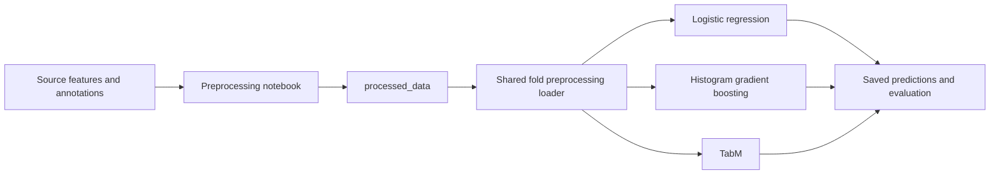

# AFIB classification with noisy or missing ECG measurements

Aaditya Pathak · Siwen Wang · Jiayi Huang

COMP90051 Statistical Machine Learning

We will compare logistic regression, histogram gradient boosting and TabM to
find whether feature construction and training augmentation improve AFIB
classification when extracted ECG measurements are incomplete or noisy.
Data preparation, logistic regression and TabM experiments are complete.
The saved logistic regression run contains 933 converged fits across 90
fold/variant combinations; TabM contains 971 fits across 80 combinations.
Both use all ten outer patient folds. Histogram gradient boosting and the full
three-model comparison remain pending. See the algorithm READMEs for training
and the checks below for independently verifying the saved results.

## Start here

| File or folder | One purpose |
| --- | --- |
| [Project plan](docs/Project_Plan.docx) | What we will test, how we will run it, and how we will judge the results |
| [Data insights](docs/Data_Insights.docx) | Dataset characteristics and findings from the completed analysis |
| [Preprocessing guide](docs/Preprocessing.docx) | How source data becomes the shared model input |
| [Model observations](docs/Model_Observations.md) | Detailed logistic regression and TabM findings, limitations and next evaluations |
| [Preprocessing notebook](notebooks/01_preprocessing.ipynb) | Validate and package data into `processed_data/` |
| [Data insights notebook](notebooks/00_data_insights.ipynb) | Reproduce descriptive findings and display their plots |
| [Algorithms](algorithms/) | Separate work folders for the three selected classifiers |
| [Logistic regression notebook](algorithms/logistic_regression/notebooks/04_logistic_regression_results.ipynb) | Inspect saved baseline results |
| [TabM tuning notebook](algorithms/tabm/notebooks/05_tabm_tuning.ipynb) | Run individual block settings, complete nested tuning and inspect TabM results |
| [Results](results/) | One results folder per algorithm, including saved predictions, tuning histories and reports |
| [Evaluation notebook](notebooks/02_noise_evaluation.ipynb) | Check saved predictions and calculate results after training |
| [Imputation check](notebooks/03_imputation_reliability.ipynb) | Separate engineering check for the optional learned-filling experiment |
| `src/afib/` and `tests/` | Shared preparation, evaluation and imputation code and checks |

## Inspect the completed results

Start with `results/<algorithm>/output_data/summary.csv` for means and sample SD
across outer folds, `selected_hyperparameters.csv` for model selection, and
`reports/completion.json` for scope. The observation document is generated from
these saved artifacts. SD describes fold variation; it is not a confidence
interval. The two-model observations do not replace the pending three-model
evaluation.

With the verified `processed_data/` package and model requirements installed,
these commands check saved predictions without fitting models:

```powershell
python algorithms/logistic_regression/check_results.py
python algorithms/tabm/check_results.py
```

For a downloaded result bundle without datasets or ML dependencies, use
`python scripts/verify_result_artifacts.py`. It checks the published inventory,
file hashes and fold coverage; it does not recalculate metrics.

To refresh TabM tables and figures without fitting or executing its notebook:

```powershell
python algorithms/tabm/run_full_pipeline.py --report-only --skip-notebook
```

The TabM notebook opens in inspection mode by default. Its README explains the
explicit training switch and the separate output directory for new parallel runs.

## Reproduce an experiment

1. Obtain the exact dataset releases below and run preprocessing. The saved
   configurations contain SHA-256 hashes for source files and the prepared
   package, plus the fold seed. Preserve the documented source paths when
   matching a historical manifest.
2. Use the model's recorded environment. TabM pins its packages in
   `algorithms/tabm/requirements.txt` and records Python 3.12.10 with CUDA 12.8.
   Logistic regression records Python 3.12.15; its scientific package pins are
   in `algorithms/logistic_regression/requirements-recorded.txt`. Use separate
   environments because the recorded NumPy/SciPy versions differ.
3. Check the environment and follow the model README to train into a **new**
   output directory. Existing historical configurations and results are evidence
   of completed runs and should not be overwritten.
4. Run the appropriate result checker with `--output <new-run>` and the test
   suite. Compare metrics and fold coverage before treating a rerun as equivalent.

```powershell
python scripts/check_environment.py --model tabm
python scripts/check_environment.py --model logistic_regression
python scripts/verify_preprocessing.py
python -m unittest discover -s tests -v
```

`verify_preprocessing.py` rebuilds all prepared files in a temporary local folder
and compares their hashes and full manifest with both completed experiments. It
does not replace the existing prepared data. The local verification reproduced
all four files byte for byte; its report is in
`results/comparison/reports/preprocessing_validation.json`. Keep source CSV bytes
unchanged (including line endings), and keep only one active dataset extraction
under `data/`.

Each environment check reports exact recorded-version differences and returns
nonzero on a mismatch. Run the relevant check in its model's environment;
neither command imports Torch or starts training. Matching recorded versions is
necessary for the historical environment claim, but does not establish identical
hardware, drivers or all transitive dependencies. CPU and different-GPU reruns
can produce different floating-point results. The saved checkers establish
prediction/metric consistency without claiming a new training run occurred.

## Run preprocessing

Use Python 3.12 from this repository folder:

```powershell
python -m pip install -r requirements.txt
python -m unittest discover -s tests -v
python -m jupyter lab notebooks/01_preprocessing.ipynb
```

Download the three CSVs from the dataset links below and keep this layout
(the PTB-XL+ folder may have any name; keep only one active copy):

```text
data/
  ptb-xl-plus/
    features/ecgdeli_features.csv
    labels/ptbxl_statements.csv
  reference/ptbxl_database.csv
```

Run the notebook top to bottom. For a command-line run without saving another notebook:

```powershell
python scripts/execute_notebook.py notebooks/01_preprocessing.ipynb
```

Its only generated deliverable is **`processed_data/`**. The folder holds the
selected measurements, labels, patient folds, quality metadata and a manifest.
The notebook performs no EDA, classifier training or evaluation reporting.



Before fitting a classifier, call `load_prepared_split` from
`src/afib/data_preparation.py`. It returns ready-to-fit training and validation
matrices. Filling, scaling and category encoding are learned from the current
training patients only. Keeping this last preparation step inside the shared
loader prevents leakage during the planned 10 outer / 3 inner fold validation.
See the [algorithm input example](algorithms/README.md).

## Data and experiment

Use [PTB-XL+ 1.0.1 ECGDeli features](https://physionet.org/content/ptb-xl-plus/1.0.1/)
with [PTB-XL 1.0.3 annotations](https://physionet.org/content/ptb-xl/1.0.3/):
21,799 ECGs from 18,869 patients, including 1,514 AFIB-labelled records (6.95%).
Use 504 lead fields; keep labels, IDs, quality flags and 27 Global fields outside
predictors. Both datasets require CC BY 4.0 attribution.

The four planned arms compare original versus enhanced features and observed
versus augmented training. All three classifiers use the same patient folds.
The project plan owns the full protocol, tuning grids and reporting rules.
The separate ridge-filling experiment uses logistic regression only.

## Repository contents

```text
algorithms/
  logistic_regression/          # model, runner, checker, requirements, README
    notebooks/                 # algorithm-specific result notebook
  histogram_gradient_boosting/  # reserved implementation; see its README
    notebooks/
  tabm/                        # model, runners, checker, requirements, README
    notebooks/                 # algorithm-specific tuning notebook
results/
  logistic_regression/
  histogram_gradient_boosting/  # reserved until implemented
  tabm/
  comparison/                  # combined three-model evaluation inputs
notebooks/                     # shared preprocessing, EDA and evaluation
src/afib/                      # shared data preparation and evaluation code
tests/                         # shared and algorithm-specific checks
scripts/                       # shared notebook execution and audits
docs/                          # project plan and guides
data/                          # canonical source CSVs tracked; extra files ignored
processed_data/                # existing shared package tracked; extra files ignored
reports/                       # shared analysis, document work and legacy files
```

Every algorithm uses the same code-folder convention and a matching folder in
`results/`. Within each results folder, `output_data/` holds tables and fold
artifacts, `reports/` holds figures and completion reports, `predictions/` holds
exports, and `pilots/` isolates smaller runs. Run configuration and preserved
source provenance stay at the run root. TabM keeps binary resume models in
`checkpoints/`; existing logistic regression pipeline pickles stay with their
fold artifacts. See the [results layout and old-to-new paths](results/README.md).

Existing experiment artifacts remain available under `results/`.
TabM binary resume checkpoints and live logs stay local. Original source data,
prepared data, local environments, shared reports and caches have ignore rules
for new files. **The three canonical source CSVs and five prepared-data files
were already tracked before those rules and remain tracked.** `.gitignore` does
not remove them from Git; no existing tracked datasets were removed in this
cleanup. `.gitattributes` preserves their bytes and result bytes across checkouts
so recorded hashes survive line-ending settings. The existing data packages and
saved experiment contents are preserved. Recorded training sources/configurations remain verifiable; workflow
and scheduling improvements do not retroactively change the completed runs.

Previous mixed notebooks, generated evidence and one-off editing scripts are
preserved locally under `reports/legacy/`; they are not part of the active
workflow or the GitHub upload.

## Rebuild the observations

```powershell
python -m pip install -r requirements-docs.txt
python scripts/build_model_observations.py
```

This regenerates the [Markdown observations](docs/Model_Observations.md), its
[Word companion](docs/Model_Observations.docx), comparison tables and input-hash
manifest without fitting any model. Markdown is the reviewed reading copy;
Word passed structural checks, but page rendering was unavailable in the local
bundled runtime, so its pagination has not been visually verified.

## Prepare the commit

Review the diff, then follow the staging and checksum commands in
[the results guide](results/README.md). The `.gitattributes` change requires
renormalizing already tracked data and result files before committing; otherwise
the Git index can retain older line-ending conversions even when the working
files pass validation. No commit or push is performed by the verification tools.
