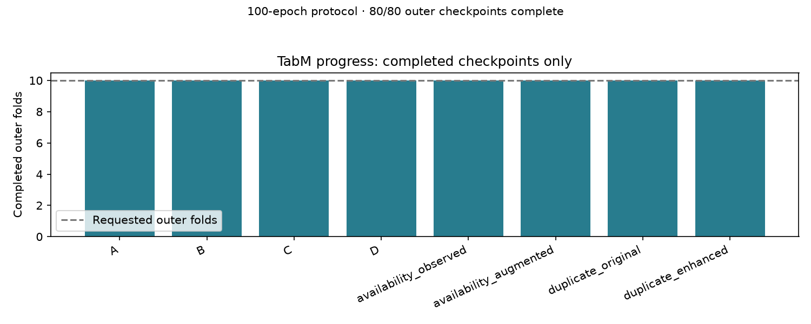
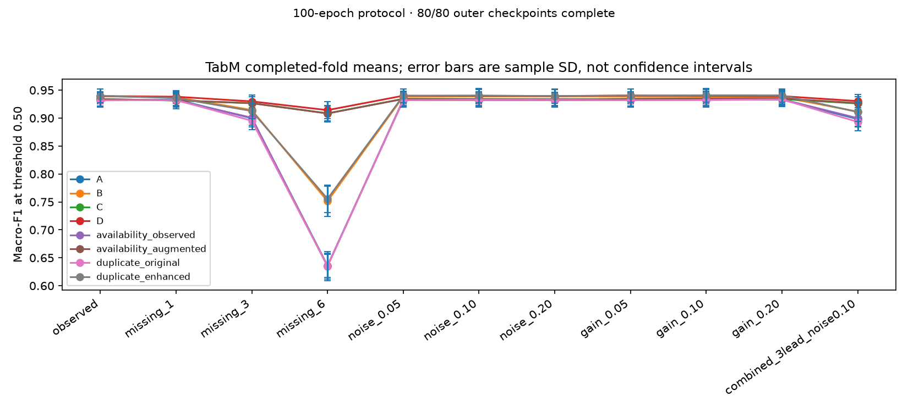
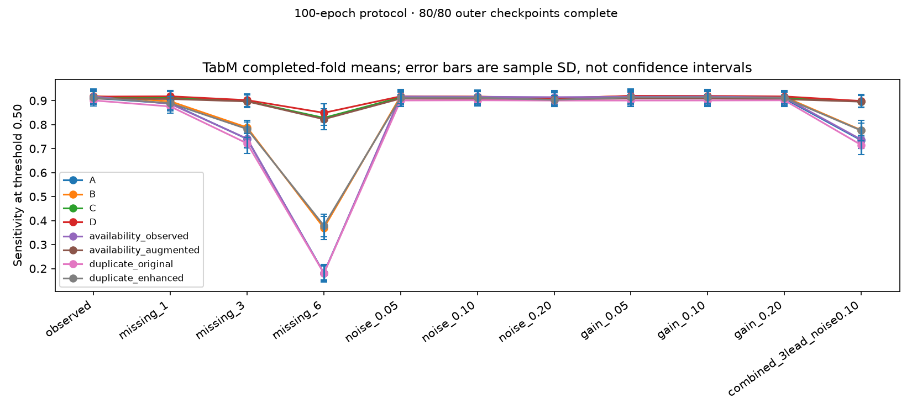
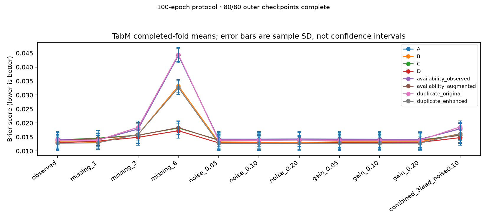
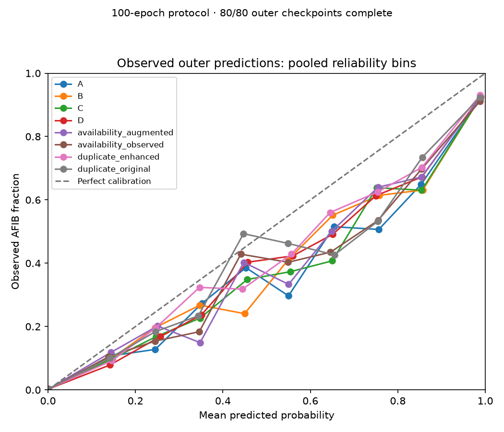
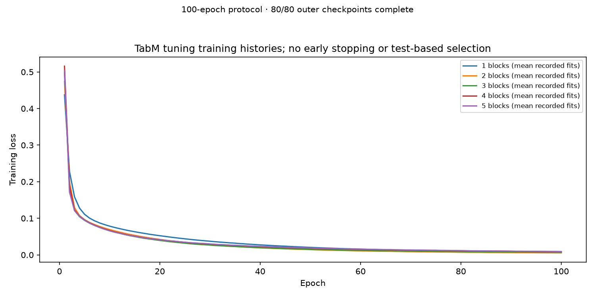

# TabM experiment report — COMPLETE TABM PLAN

Generated 2026-10-13T08:20:55.895892+00:00. Requested scope: **complete**.
**80/80 outer-fold/variant checkpoints** and **10/10 complete outer folds** are available.
There are **891 completed inner fits**, **80 outer refits**, and **297 fully evaluated tuning candidates**.
The initial grid requires 720 inner fits; endpoint refinement can require more.
Completing a reduced run does not establish completion of the project plan.

Only completed outer checkpoints enter performance summaries. Partial tuning scores are validation scores, not final model results. A single completed outer fold has undefined sample SD. Empty figures mean the relevant results are not available; no values have been estimated or fabricated.

## Settings and runtime

Requested variants: A, B, C, D, availability_observed, availability_augmented, duplicate_original, duplicate_enhanced. Outer folds: [0, 1, 2, 3, 4, 5, 6, 7, 8, 9]; inner folds: 3.
Initial block grid: [2, 3, 4]; one-step endpoint refinement: True.
Every fit requests 100 epochs and batch size 256; stress repeats: 3 (31 conditions per outer checkpoint).
Device: cuda; seed: 20261008.
Sum of completed-fold wall times: 47064.6 seconds (not total elapsed experiment time).

```json
{
  "architecture": {
    "width": 128,
    "members": 16,
    "dropout": 0.1,
    "numerical_embeddings": false
  },
  "optimizer": {
    "name": "AdamW",
    "learning_rate": 0.0003,
    "weight_decay": 0.0001
  },
  "versions": {
    "python": "3.12.10",
    "numpy": "2.5.1",
    "pandas": "3.0.6",
    "torch": "2.7.1+cu128",
    "tabm": "0.0.3"
  }
}
```

## Observed performance at the fixed 0.50 threshold

| variant | metric | mean | sd | n_folds | n_defined |
| --- | --- | --- | --- | --- | --- |
| A | macro_f1 | 0.9321 | 0.0126 | 10 | 10 |
| A | sensitivity | 0.9108 | 0.0258 | 10 | 10 |
| A | specificity | 0.9871 | 0.0039 | 10 | 10 |
| A | brier | 0.0142 | 0.0028 | 10 | 10 |
| B | macro_f1 | 0.9389 | 0.0137 | 10 | 10 |
| B | sensitivity | 0.9199 | 0.0291 | 10 | 10 |
| B | specificity | 0.9884 | 0.0028 | 10 | 10 |
| B | brier | 0.0133 | 0.0027 | 10 | 10 |
| C | macro_f1 | 0.9338 | 0.0121 | 10 | 10 |
| C | sensitivity | 0.9134 | 0.0281 | 10 | 10 |
| C | specificity | 0.9874 | 0.0035 | 10 | 10 |
| C | brier | 0.0140 | 0.0026 | 10 | 10 |
| D | macro_f1 | 0.9395 | 0.0122 | 10 | 10 |
| D | sensitivity | 0.9166 | 0.0261 | 10 | 10 |
| D | specificity | 0.9889 | 0.0030 | 10 | 10 |
| D | brier | 0.0129 | 0.0027 | 10 | 10 |
| availability_augmented | macro_f1 | 0.9340 | 0.0132 | 10 | 10 |
| availability_augmented | sensitivity | 0.9081 | 0.0312 | 10 | 10 |
| availability_augmented | specificity | 0.9879 | 0.0035 | 10 | 10 |
| availability_augmented | brier | 0.0138 | 0.0029 | 10 | 10 |
| availability_observed | macro_f1 | 0.9332 | 0.0132 | 10 | 10 |
| availability_observed | sensitivity | 0.9174 | 0.0299 | 10 | 10 |
| availability_observed | specificity | 0.9868 | 0.0034 | 10 | 10 |
| availability_observed | brier | 0.0142 | 0.0028 | 10 | 10 |
| duplicate_enhanced | macro_f1 | 0.9397 | 0.0120 | 10 | 10 |
| duplicate_enhanced | sensitivity | 0.9127 | 0.0252 | 10 | 10 |
| duplicate_enhanced | specificity | 0.9894 | 0.0025 | 10 | 10 |
| duplicate_enhanced | brier | 0.0128 | 0.0026 | 10 | 10 |
| duplicate_original | macro_f1 | 0.9317 | 0.0117 | 10 | 10 |
| duplicate_original | sensitivity | 0.9007 | 0.0239 | 10 | 10 |
| duplicate_original | specificity | 0.9879 | 0.0030 | 10 | 10 |
| duplicate_original | brier | 0.0139 | 0.0025 | 10 | 10 |

## Protocol and interpretation

All preprocessing, imputation, scaling and augmentation are fitted using training patients only. Block count is selected using mean inner-fold macro-F1; ties favor fewer blocks. The secondary threshold is selected from inner out-of-fold predictions to target sensitivity 0.90, then frozen for every outer condition. It is an exploratory threshold, not a clinical acceptance criterion.

Stress repeats are averaged within each outer fold before calculating the outer-fold mean and sample SD. Undefined metrics propagate through both aggregation stages. Error bars are descriptive sample SD, not confidence intervals; outer folds share training data. Positive paired stress deterioration means performance becomes worse (stress minus observed for Brier; observed minus stress otherwise). Method differences are left minus right on the intersection of completed folds, for both threshold policies.

The reports include B–A, D–C, C–A and D–B plus B/availability-observed, D/availability-augmented and both duplicate controls when paired results exist. Patient-weighted metrics give each patient total weight one. Quality groups use recorded source annotations; an absent flag does not prove a clean signal. The simulated tabular corruptions are not calibrated ECG waveform artefacts.

Majority baseline: computed from training labels only; current data manifest verified. It can be computed before any model finishes and is not evidence of completed model training.

## Figures













Calibration pools observed test records into ten probability bins across completed folds. Training curves average recorded histories at each epoch; they do not select the final model.

## Saved evidence

The sibling `output_data/` directory contains raw fold tables, predictions, tuning candidates, `summary.csv`, `fold_mean_metrics.csv`, paired contrasts, patient-weighted and quality-group summaries, majority baseline, and tuning progress. Checkpoint models are stored separately in `checkpoints/`. `completion.json` records missing checkpoints and precise coverage. Source hashes, processed-data manifest, and runtime versions are preserved in `../run_config.json`.

These report-generation coverage checks do not replace the independent `check_results.py` audit, which recalculates saved prediction metrics and checks patient separation, complete scenario coverage and settings. No results from other classifiers are required for this TabM report.
